# Evaluation in existing papers related to prefix sharing

## BatchLLM
- Does not mention about any specific datasets, self-created
- Compares only with vLLM (its different modes), SGLANG and other attention kernels

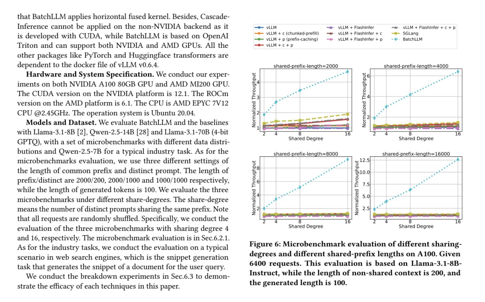
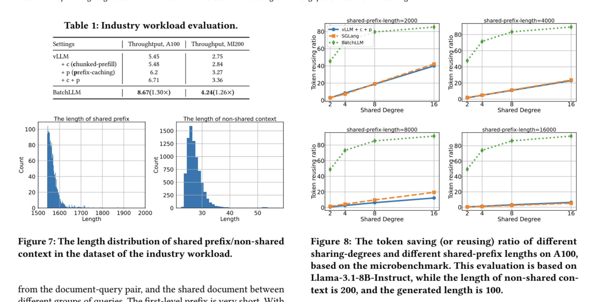

## SGLang
- Datasets not too relevant for us

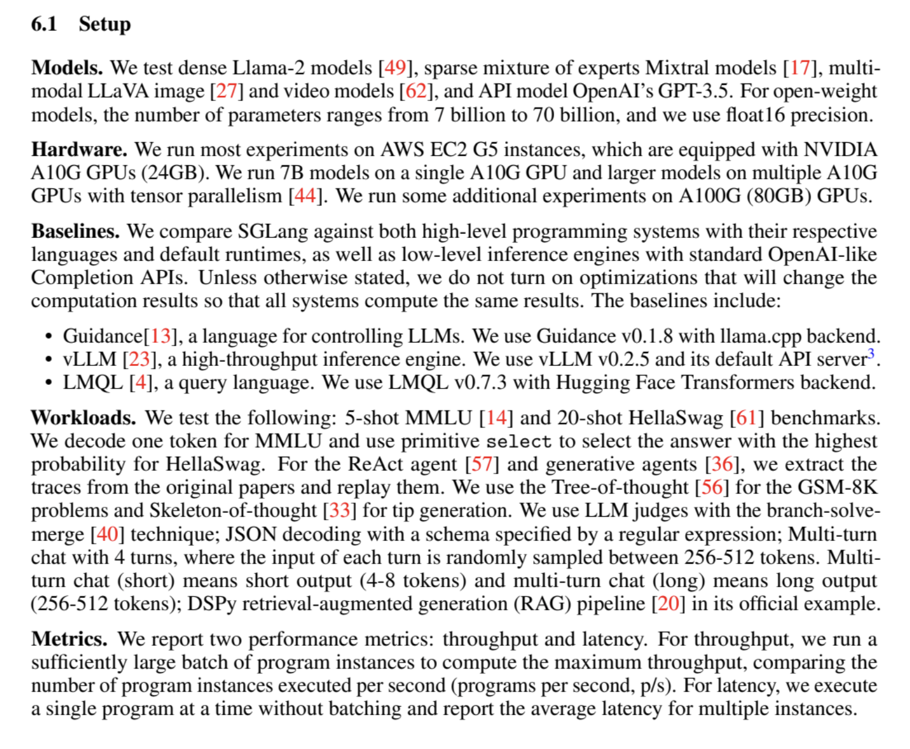

## PromptCache
- Compares both for CPU and GPU
- TTFT and Memory Stage Overhead
- A relevant dataset: [LongBench](https://github.com/THUDM/LongBench)
- They highlight - reduced TTFT, but end-to-end latency roughly the same for larger number of output tokens
- Uses just simple KV Caching as the baseline comparison point

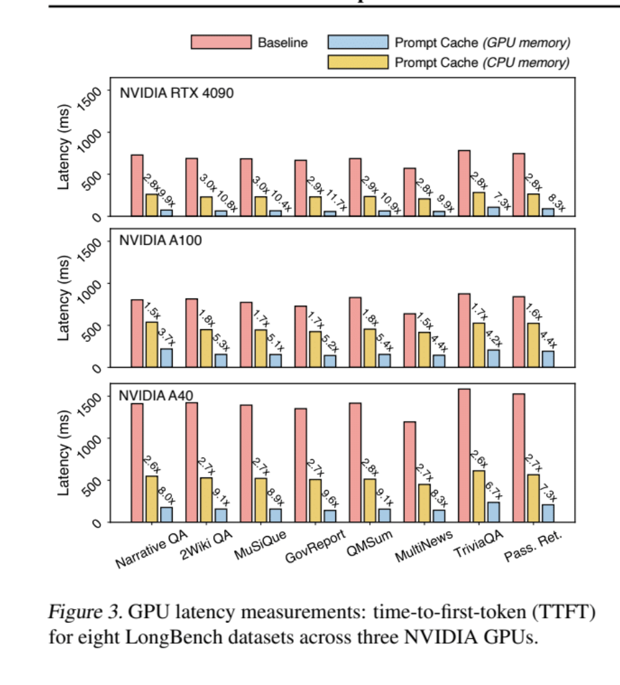

## HydraGen
-  Split full-sequence attention into separate attention computations over the shared prefix and unique suffixes that can be combined to recover the full attention result

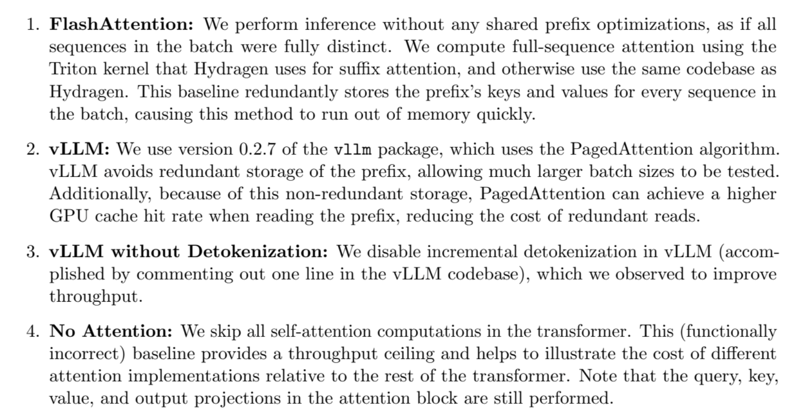

- Tokens per second as a throughput metric
- A self created dataset

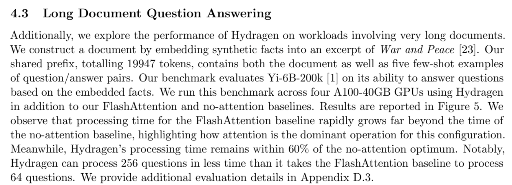

- [APPS Dataset](https://github.com/hendrycks/apps?tab=readme-ov-file)

## HotPrefix
- Following baselines and metrics

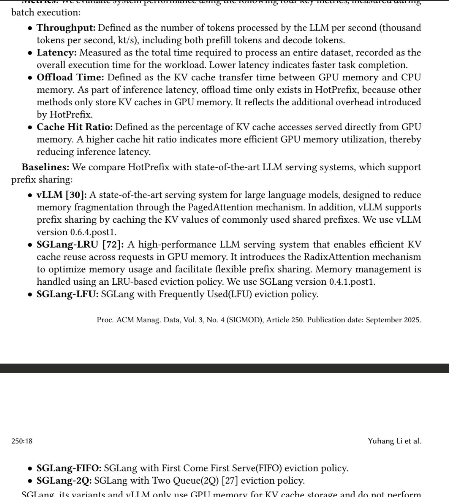

- [MMLU](https://huggingface.co/datasets/cais/mmlu), [HellaSwag](https://huggingface.co/datasets/Rowan/hellaswag), [BBH](https://huggingface.co/datasets/lukaemon/bbh), [CEVAL](https://cevalbenchmark.com) - Not relevant

## FastTree
- Compares with different attention mechanisms

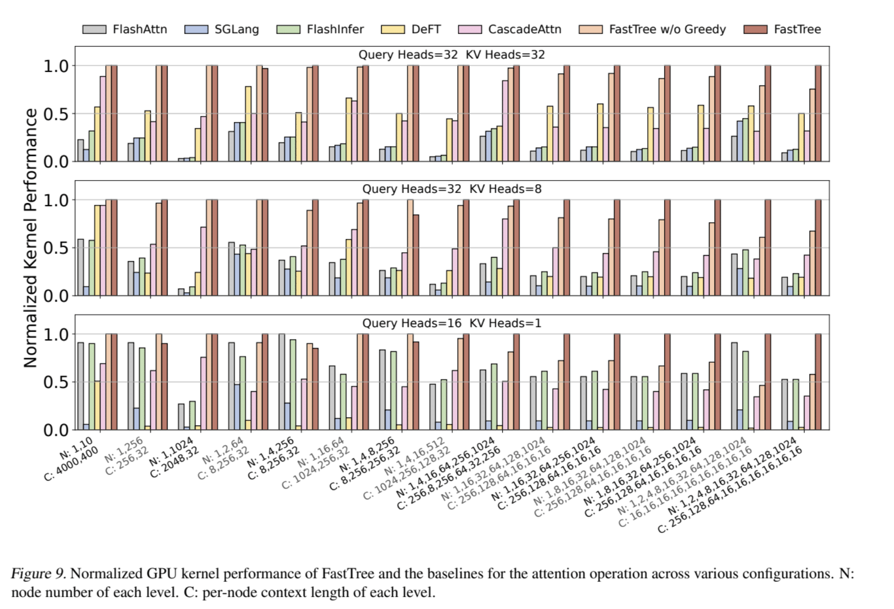

- A relevant dataset: [Big Prompt Library](https://github.com/0xeb/TheBigPromptLibrary)
- End to end latency, and breakdown of execution into different stages as metrics

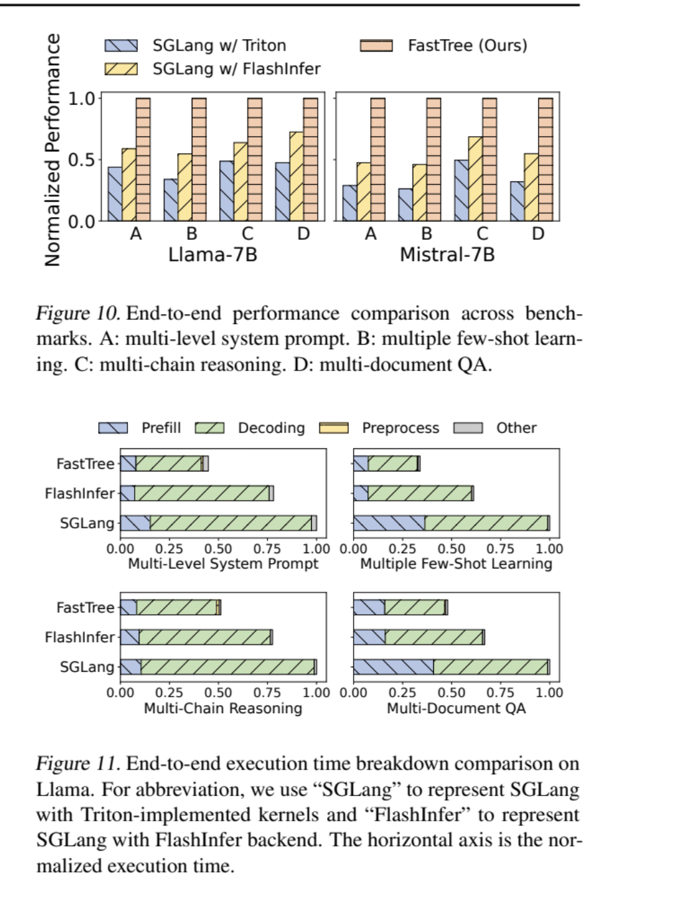

## ChunkAttention
- Comparison with vLLM and Transformers
- Poison Request Arrival
- Latency as a measure (ms/tok)
- Dataset not mentioned

## Pensieve
- For multi-turn datasets
- [ShareGPT](https://huggingface.co/collections/bunnycore/sharegpt-datasets), [UltraGPT](https://github.com/thunlp/UltraChat)
- Poisson based request arrival
- Against vLLM, TensorRTLLM

## CacheBlend
- For RAG
- [Musique](https://github.com/StonyBrookNLP/musique) (Not too relevant)

## vLLM
- Comparison with Orca
- Translation Dataset - [WMT16](https://huggingface.co/datasets/wmt/wmt16)

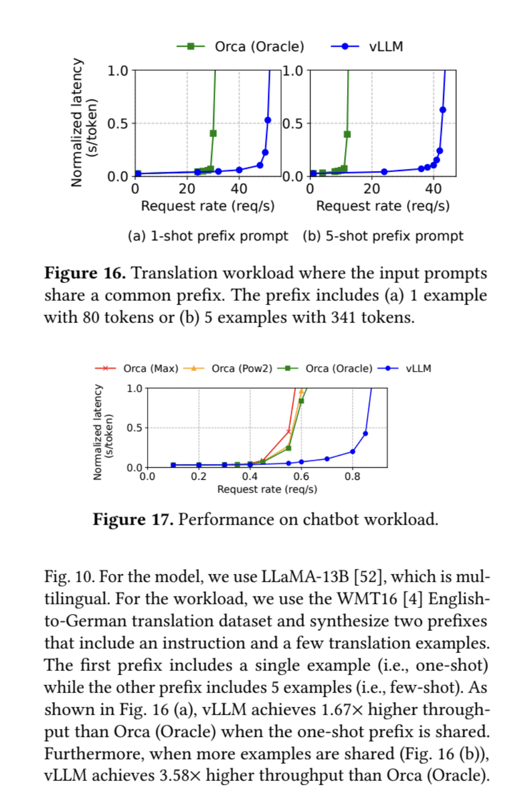

## BucketServe
- [Alpaca](https://huggingface.co/datasets/tatsu-lab/alpaca), [LongBench](https://github.com/THUDM/LongBench)
- Comparison with UELLM, DistServe
- Following Metrics:

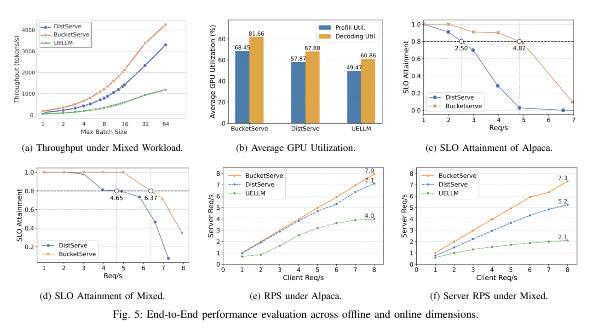

## FastServe
- Multi-level Feedback Queue
- [Alpaca](https://huggingface.co/datasets/tatsu-lab/alpaca), [ShareGPT](https://huggingface.co/collections/bunnycore/sharegpt-datasets)
- Baselines: FasterTransformer, vLLM
- Metrics: p95 user-perceived latency

## LoongServe
- For long contexts
- Datasets: [ShareGPT](https://huggingface.co/collections/bunnycore/sharegpt-datasets), [L-Eval](https://github.com/OpenLMLab/LEval), [LV-Eval](https://github.com/infinigence/LVEval)
- Baselines: vLLM, DeepSpeed-MII, LightLLM, DistServe
- Poisson request arrival pattern
- Metrics: Per-token Latency, Input Latency, Output Latency

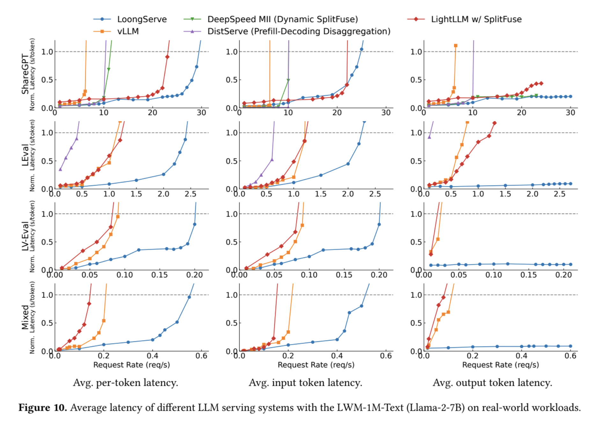

## PrefillOnly
- Self Created Dataset

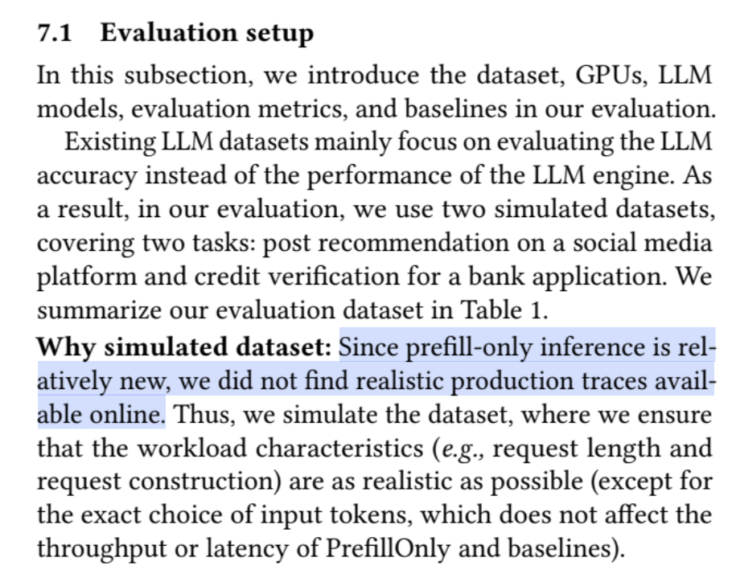

- Poisson request arrival pattern
- Baselines: different vLLM modes
- Mean Latency vs QPS

## SarathiServe
- Datasets: [openchat_sharegpt4](https://huggingface.co/datasets/openchat/openchat_sharegpt4_dataset), [arxiv_summarization](https://huggingface.co/datasets/ccdv/arxiv-summarization)
- Baselines: vLLM, ORCA
- Metrics: max capacity, TBT, TTFT

## PodAttention
- Metrics: TTFT, TBT, Execution Latency
- Baselines: vLLM, SarathiServe
- Datasets - Internal Enterprise Workload, [arxiv_summarization](https://huggingface.co/datasets/ccdv/arxiv-summarization)

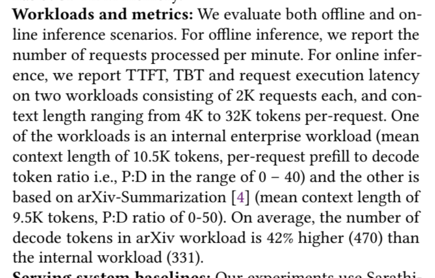 

## Lluminix
- Poisson and Gamma Request Arrival Patterns
- Datasets - [ShareGPT](https://huggingface.co/collections/bunnycore/sharegpt-datasets), [BurstGPT](https://github.com/HPMLL/BurstGPT), self-created dataset

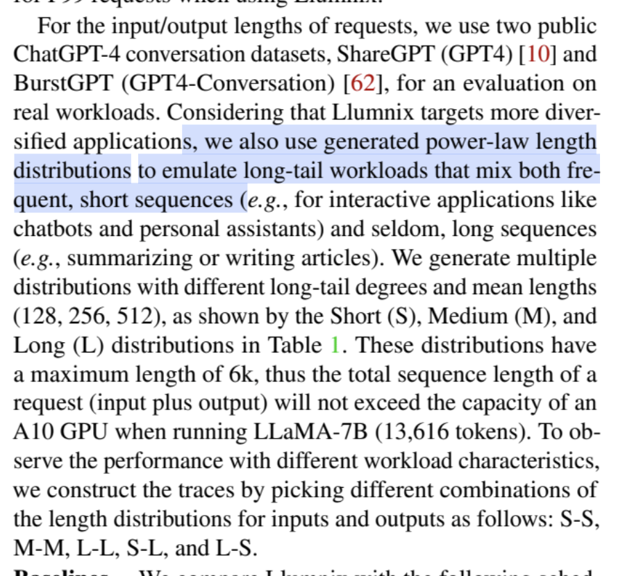

- Metrics: end to end latency, prefill and decode
- Baselines: INFaaS++

## ORCA
- Comparison with FasterTransformer

- Self created dataset

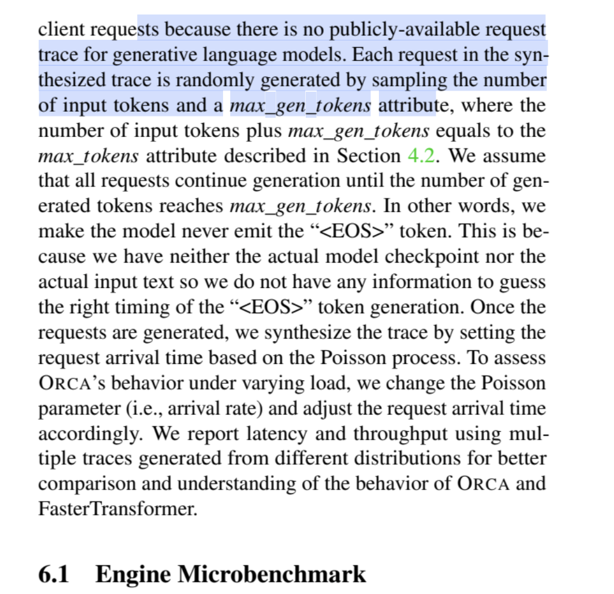

- Metrics: execution time, norm latency

## DynamicBatching
- Comparison with vLLM
- Dataset didn't mention

## DistServe
- [ShareGPT](https://huggingface.co/collections/bunnycore/sharegpt-datasets), [HumanEval](https://huggingface.co/datasets/openai/openai_humaneval), [LongBench](https://github.com/THUDM/LongBench)
- Metric: SLO Attainment
- vLLM and DeepSpeed-MI

